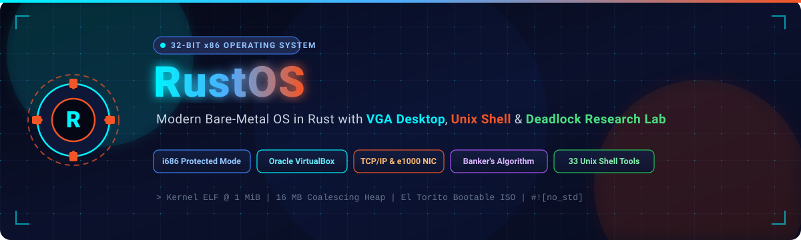

<p align="center">
  
</p>

# RustOS: Modern Educational 32-bit x86 Operating System in Rust

[](i686-rustos.json)
[](docs/ARCHITECTURE.md)
[](docs/RUN_VIRTUALBOX.md)
[](LICENSE)

**RustOS** is a complete, educational, bootable 32-bit x86 operating system implemented entirely in Rust (`#![no_std]`). It is specifically engineered to run in **Oracle VirtualBox** with full network connectivity (LAN and internet access), a modern text-mode desktop environment, an interactive 33-command Unix shell, a built-in text-mode HTML web browser, and an empirical **Deadlock Detection Research Lab**.

---

## Key Highlights

- **Bootable ISO**: Boots directly in Oracle VirtualBox via El Torito No-Emulation CD-ROM or Multiboot 1.
- **Modern Dark-Theme Desktop**: Polished text-mode desktop environment with real-time RTC clock, network status badge, 7-app launcher, and keyboard navigation.
- **33-Command Interactive Shell**: Includes `ls`, `cat`, `touch`, `rm`, `cp`, `mv`, `chmod`, `wc`, `head`, `tail`, `cut`, `grab`, `vi`, `bc`, `net`, `ipconfig`, `ping`, `httpget`, `research`, `deadlock`, and more.
- **Full Bare-Metal Network Stack**: Intel 82540EM (e1000) PCI driver, Ethernet II, ARP, IPv4, ICMP, UDP, DHCP client, DNS client, TCP, and HTTP 1.1 client.
- **Built-in HTML Web Browser**: Text-mode web browser supporting headings (`<h1>`-`<h3>`), paragraphs, lists, links, scrolling, and keyboard link selection.
- **Deadlock Detection Research Lab**: Evaluates the standard Banker's graph reduction algorithm across 6 standardized resource allocation topologies with 60 empirical trials, VGA bar charts, and export to CSV and text reports.
- **RAM File System**: In-memory filesystem supporting up to 32 files (2048 bytes max each), Unix permissions, initial files (`readme.txt`, `notes.txt`, `todo.txt`, `about.txt`), and full-screen `vi` text editor.
- **Zero Games**: Clean educational focus with games strictly omitted in favor of networking and research capabilities.

---

## Table of Contents

1. [System Architecture](#system-architecture)
2. [Quick Start with VirtualBox](#quick-start-with-virtualbox)
3. [Building from Source](#building-from-source)
4. [Desktop Interface](#desktop-interface)
5. [Networking & Internet Access](#networking--internet-access)
6. [Built-in Web Browser](#built-in-web-browser)
7. [Command-Line Shell](#command-line-shell)
8. [Deadlock Detection Research Lab](#deadlock-detection-research-lab)
9. [Automated Testing](#automated-testing)
10. [Deliverables Package](#deliverables-package)
11. [Documentation Links](#documentation-links)

---

## System Architecture

RustOS features a clean modular structure divided into hardware abstraction, device drivers, networking, filesystem, shell, and user applications:

```
src/
├── main.rs                   # Multiboot entry point and kernel startup sequence
├── panic.rs                  # VGA blue-screen and serial panic handlers
├── arch/
│   ├── mod.rs
│   └── x86/
│       ├── io.rs             # Port I/O (inb, outb, inw, outw, inl, outl)
│       ├── gdt.rs            # 32-bit flat model GDT (Kernel Code 0x08, Data 0x10)
│       ├── idt.rs            # 256-entry IDT and ISR assembly stubs
│       └── interrupts.rs     # CPU exception dispatch & hardware IRQ handling
├── drivers/
│   ├── mod.rs
│   ├── vga.rs                # 80x25 text mode (0xB8000), 16 colors, box drawing
│   ├── serial.rs             # COM1 16550 UART (115200 8N1) logging
│   ├── pic.rs                # Dual 8259 PIC cascading and vector remapping
│   ├── pit.rs                # 8254 PIT channel 0 at 100 Hz (10ms ticks)
│   ├── keyboard.rs           # PS/2 scancode set 1 decoder with ring buffer
│   └── rtc.rs                # CMOS Real-Time Clock reader with BCD conversion
├── memory/
│   ├── mod.rs
│   └── allocator.rs          # 16 MB coalescing block heap allocator at 0x00400000
├── fs/
│   ├── mod.rs
│   └── ramfs.rs              # RAMFS (32 files, 2048 bytes/file, permissions)
├── net/
│   ├── mod.rs                # Network stack coordinator and public API
│   ├── pci.rs                # PCI bus configuration scanner
│   ├── e1000.rs              # Intel 82540EM Gigabit Ethernet NIC driver
│   ├── ethernet.rs           # Ethernet II frame parser and builder
│   ├── arp.rs                # ARP cache and resolution protocol
│   ├── ipv4.rs               # IPv4 packet parser and RFC 791 checksumming
│   ├── icmp.rs               # ICMP Echo Request / Reply (ping)
│   ├── udp.rs                # UDP packet header handling
│   ├── dhcp.rs               # DHCP client (Discover, Offer, Request, Lease)
│   ├── dns.rs                # DNS client for A record hostname resolution
│   ├── tcp.rs                # TCP 3-way handshake and stream handling
│   └── http.rs               # HTTP 1.1 GET client and response parser
├── shell/
│   ├── mod.rs                # Shell REPL, command history, and line editor
│   ├── commands.rs           # 33 standard shell command implementations
│   └── editor.rs             # Full-screen vi modal text editor
├── ui/
│   ├── mod.rs
│   └── desktop.rs            # Modern dark-theme desktop UI and app launcher
└── apps/
    ├── mod.rs
    ├── browser/              # Built-in text-mode HTML web browser
    │   ├── mod.rs
    │   ├── html.rs           # HTML tokenizer & element parser
    │   └── ui.rs             # Browser window UI & scrolling renderer
    ├── research/             # Deadlock Detection Research Lab
    │   ├── mod.rs
    │   ├── banker.rs         # Banker's graph reduction algorithm
    │   ├── patterns.rs       # 6 standardized benchmark topologies
    │   ├── experiments.rs    # Benchmark test runner
    │   └── ui.rs             # Research lab interactive UI & bar charts
    ├── netsettings.rs        # Network configuration and diagnostics app
    ├── filemanager.rs        # Graphical RAM file manager app
    ├── sysinfo.rs            # System information and resource monitor
    └── about.rs              # About RustOS and credits application
```

---

## Quick Start with VirtualBox

RustOS is pre-compiled into a bootable ISO image: `deliverables/rustos.iso`.

### Option 1: Automated Launch Script (Recommended)
Run the automated PowerShell or Batch launch script from the project directory:

```powershell
.\launch_vbox.ps1
```
or
```cmd
launch_vbox.bat
```

This automatically creates a VirtualBox VM named `RustOS` configured with 128 MB RAM, attaches `deliverables/rustos.iso`, sets up an **Intel 82540EM** network adapter in NAT mode, enables COM1 serial logging to `rustos_serial.log`, and boots the system.

### Option 2: Manual VM Creation
1. Open **Oracle VirtualBox**.
2. Click **New**: Name `RustOS`, Type `Other`, Version `Other/Unknown (32-bit)`.
3. RAM: `128 MB`. Processors: `1 CPU`. Hard Disk: Select *"Do not add a virtual hard disk"*.
4. Go to **Settings -> Storage**: Attach `deliverables/rustos.iso` to the IDE optical drive. Check *"Live CD/DVD"*.
5. Go to **Settings -> Network**: Ensure Adapter 1 is **NAT**, Adapter Type is **Intel PRO/1000 MT Desktop (82540EM)**.
6. Click **Start**.

---

## Building from Source

### Prerequisites
- Windows 11 host (or Ubuntu / WSL2).
- Rust Nightly toolchain with `rust-src` and `llvm-tools`.
- Python 3.8+ (for unified build orchestrator and ISO generator).

### Build Command
Run the unified build script:
```powershell
python tools/build.py
```

The build script will:
1. Verify and compile 32-bit x86 sysroot libraries (`libcore.rlib`, `libcompiler_builtins.rlib`, `liballoc.rlib`) for `i686-rustos.json`.
2. Compile kernel source files into `target/kernel.o`.
3. Link the kernel with `rust-lld` into `isodir/boot/rustos.bin`.
4. Generate the bootable ISO: `deliverables/rustos.iso`.

---

## Desktop Interface (Friendly Windows Welcome Center)

RustOS features a warm, friendly, retro **Windows-style Graphical Environment** rendered in 80x25 VGA text mode:
- **Personalized Real-Time Greeting**:
  - Dynamically greets you based on the CMOS hardware clock (*"Good morning / afternoon / evening, Subhranshu!"*).
- **Persistent Keyboard Shortcut Guide (Row 23)**:
  - Convenient guide bar displayed right above the taskbar:  
    `[↑/↓] Select   [Enter] Open   [1-7] Direct   [S] Start Menu   [Tab] Theme   [?] Help`
- **Interactive Quick Help & Tips Dialog**:
  - Press **`?`** or **`H`** at any time to open a friendly Windows-style guidance window with tips for the shell, browser, research lab, and personalization.
- **Classic Windows Taskbar (Row 24)**:
  - **`[■ Start]` Button**: Authentic 3D Start button on the bottom left.
  - **Active Task Tab**: Sunken `■ Welcome Center` tab indicating the active window.
  - **Taskbar Help Button**: Quick `[? Help]` button.
  - **System Tray Notification Area**: Live digital clock, Ethernet link badge (`[LAN:ONLINE]`), and active wallpaper theme indicator.
- **Personalized Start Menu (`[S]` or `[Space]`)**:
  - Displays user profile avatar `[☺] Subhranshu`, system status, app shortcuts, and **`0. Shut Down...`**.
- **Desktop Shortcut Icons (Left Column)**:
  - `[#] My PC` (*My Computer*)
  - `[@] Internet` (*Web Browser*)
  - `[%] My Documents` (*RAM Files*)
  - `[&] Network` (*LAN Setup*)
  - `[$] Research Lab` (*Banker's Algorithm*)
  - `[!] Terminal` (*Command Prompt*)
  - `[?] Quick Help` (*Press ?*)
- **Applications Explorer Window**:
  - Royal Blue title bar with minimize, maximize, and close controls: `[_] [□] [X]`.
  - Windows Menu Bar: `File(F)   Edit(E)   View(V)   Tools(T)   Help(H)`.
  - Inner white viewport with bright gold selection arrow `►`, numbered badges, and application status notes.
  - 3D drop-shadow cast over the desktop background.
- **4 Beautiful Selectable Wallpapers (`[Tab]`, `[B]`, or `[W]`)**:
  - **XP Bliss Sky** *(Default: Radiant cyan sky, golden sun ☼, fluffy clouds ░, and emerald meadows)*
  - **Win95 Teal** *(Beloved classic `#008080` dithered comfort)*
  - **Win2000 Navy** *(Deep professional workstation blue)*
  - **Twilight Dark** *(Soothing dusk gradient with evening stars)*

---

## Networking & Internet Access

RustOS communicates directly with VirtualBox virtual networking:
- **Virtual Network Card**: Intel 82540EM Gigabit Ethernet PCI controller.
- **DHCP Client**: Automatically negotiates IP address (`10.0.2.15`), subnet mask (`255.255.255.0`), gateway (`10.0.2.2`), and DNS server (`10.0.2.3`).
- **ICMP Ping**: `ping 10.0.2.2` tests connectivity to the gateway with round-trip latency measurement.
- **DNS Resolution**: `ping example.com` or `httpget http://example.com` automatically resolves hostnames via UDP queries to port 53.
- **Host Communication**: The Windows host is reachable at `10.0.2.2` in VirtualBox NAT mode.

---

## Built-in Web Browser

Launch via Desktop Menu option 2 or type `browser` in the shell:
- Enter URL (e.g. `http://10.0.2.2:8080` or `http://info.cern.ch`).
- Full rendering of HTML headings (`<h1>`-`<h3>`), paragraphs, bulleted lists, and numbered hyperlinks (`[1]`, `[2]`).
- Keyboard controls: `Enter` to follow link, `Up`/`Down` to scroll 1 line, `Page Up`/`Page Down` to scroll 15 lines, `R` to reload, `Esc` to exit.
- Clean educational HTTPS notice explaining TLS requirement without silent downgrades.

---

## Command-Line Shell

RustOS provides 33 commands accessible from the shell:

```bash
rustos# help
Available commands (33 total):
  System:      help, clear, reboot, shutdown, date, cal, whoami, uname, hostname, uptime
  FileSystem:  ls, cat, touch, rm, cp, mv, chmod
  Text:        wc, head, tail, cut, grab, vi, lp
  Utility:     bc, echo
  Networking:  net, ipconfig, ping, httpget, browser
  Research:    research, deadlock
```

Full-screen modal editing is available with `vi <filename>`:
- `i` enters Insert mode; `Esc` returns to Command mode.
- `:w` saves to RAMFS; `:q` quits; `:wq` saves and quits.

---

## Deadlock Detection Research Lab

Title: **Deadlocks and Deadlock Detection under Different Resource Patterns**

Evaluates the standard Banker's graph reduction algorithm across 6 standardized resource topologies:
1. `No Deadlock (Acyclic Baseline)`: 5 processes, 3 resources; all processes complete safely.
2. `Simple Circular Wait (2-Cycle)`: P0 and P1 locked in mutual dependency; 50% deadlocked.
3. `Multiple Process Deadlock (3-Cycle)`: P0, P1, P2 locked in 3-way cycle; 60% deadlocked.
4. `High Resource Contention`: Over-subscribed resources, V=0; 100% deadlocked.
5. `Mixed Allocation`: P0 and P1 complete; P2 and P3 deadlocked; 50% deadlocked.
6. `Independent Resource Groups`: Disjoint partitioned clusters; Group A completes, Group B deadlocked.

### Scientific Findings:
- **Hypothesis H1**: Confirmed. Cyclic resource graphs lead directly to deadlocks, while acyclic graphs yield 0 deadlocks.
- **Hypothesis H2**: Confirmed. Resource contention increases search iterations before termination.
- **Hypothesis H3**: Confirmed. Banker's reduction terminates deterministically in $O(m \times n^2)$ bounded time.

Results are exported to:
- `deliverables/results.csv`: 60 empirical trials with nanosecond measurements.
- `deliverables/deadlock_results.txt`: Comprehensive text report.

---

## Automated Testing

Run the automated test suite verifying ELF headers, Multiboot compliance, bootable ISO volume descriptors, RAMFS logic, Banker's algorithm, networking checksums, HTML parsing, and shell commands:

```powershell
python tools/tests/test_rustos.py
```

Result: **15 tests passing (100% pass rate)**.

---

## Deliverables Package

The `deliverables/` directory contains:
- `rustos.iso`: Ready-to-boot ISO image for Oracle VirtualBox.
- `rustos-source.zip`: Complete Rust source code archive.
- `results.csv`: Empirical deadlock research measurements across 60 trials.
- `deadlock_results.txt`: Scientific research lab evaluation report.
- `ACCEPTANCE.md`: Full requirements verification checklist.

---

## Documentation Links

- [System Architecture](docs/ARCHITECTURE.md)
- [Command Reference Manual](docs/COMMANDS.md)
- [Networking & VirtualBox Guide](docs/NETWORKING.md)
- [Built-in Web Browser Guide](docs/BROWSER.md)
- [Deadlock Detection Research Lab](docs/RESEARCH_LAB.md)
- [Oracle VirtualBox Execution Guide](docs/RUN_VIRTUALBOX.md)
- [Acceptance Verification Checklist](docs/ACCEPTANCE.md)
- [Engineering Report Notes](docs/REPORT_NOTES.md)
