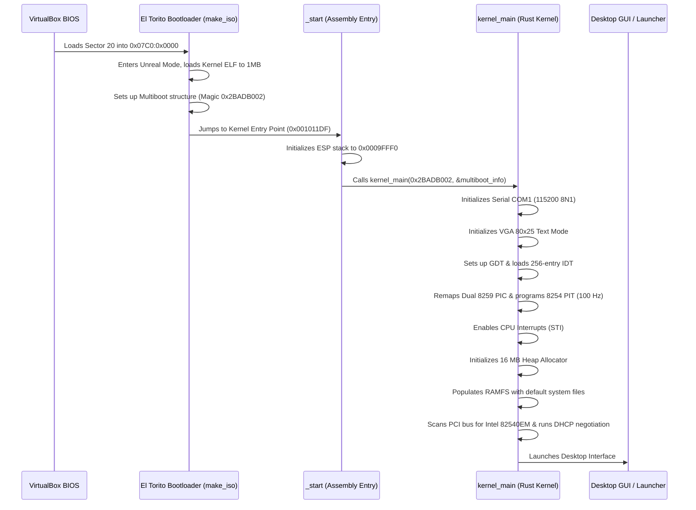

# RustOS Architecture Specification

## 1. Architectural Overview

RustOS is a monolithic educational 32-bit x86 operating system implemented in Rust (`#![no_std]`). It is engineered to boot natively in **Oracle VirtualBox** as an El Torito No-Emulation CD-ROM or Multiboot 1 compliant kernel.

```
+--------------------------------------------------------------------------+
|                     USER INTERFACE / APPLICATIONS                         |
|  [Desktop Environment]  [33-Command Shell]  [HTML Web Browser]           |
|  [Network Settings]     [RAM File Manager]  [Deadlock Research Lab]      |
|  [System Information]   [About RustOS]      [vi Text Editor]             |
+--------------------------------------------------------------------------+
|                        KERNEL SERVICES & DRIVERS                          |
|  - RAMFS (In-Memory File System, 32 Files, 2048 Bytes/File, Permissions) |
|  - TCP/IP Stack (Ethernet II, ARP, IPv4, ICMP, UDP, DHCP, DNS, TCP, HTTP)|
|  - Intel 82540EM (e1000) PCI NIC Driver (Ring Buffers, Interrupts)       |
|  - VGA 80x25 Text Mode (B8000h, Dual-Buffer, Box Drawing, 16 Colors)    |
|  - PS/2 Keyboard Driver (Scancode Set 1, Ring Buffer, Modifiers)         |
|  - Dual 8259 PIC (Remapped to IRQ 32-47) & 8254 PIT (100 Hz Ticks)       |
|  - CMOS Real-Time Clock (RTC, BCD Decoding, Century/Year/Month/Day/Time) |
|  - 16 MB Coalescing Block Heap Allocator (0x00400000 - 0x01400000)       |
|  - 16550A UART Serial Driver (COM1 at 0x3F8, 115200 Baud, 8N1)          |
+--------------------------------------------------------------------------+
|                     HARDWARE ABSTRACTION LAYER (HAL)                     |
|  - 32-bit Flat Model GDT (0x00 Null, 0x08 Kernel Code, 0x10 Kernel Data) |
|  - 256-Entry IDT (Vectors 0-31 Exceptions, 32-47 Hardware IRQs)          |
|  - Port I/O Inlines (inb, outb, inw, outw, inl, outl, io_wait)            |
|  - Multiboot 1 Specification Assembly Entry Header (0x1BADB002)           |
+--------------------------------------------------------------------------+
|                 PHYSICAL / VIRTUAL HARDWARE (VIRTUALBOX)                 |
|  - x86 32-bit CPU, 128 MB RAM, Intel 82540EM NIC, COM1 Serial, IDE CD-ROM|
+--------------------------------------------------------------------------+
```

---

## 2. Memory Map & Layout

| Physical Address Range | Size | Usage / Component | Description |
|---|---|---|---|
| `0x00000000 - 0x000003FF` | 1 KB | Real Mode IVT | Interrupt Vector Table (BIOS boot) |
| `0x00000400 - 0x000004FF` | 256 B | BIOS Data Area | BDA parameters |
| `0x00007C00 - 0x00007DFF` | 512 B | Real Mode Bootloader | El Torito boot sector stage 1 |
| `0x00007E00 - 0x000083FF` | 1.5 KB | Protected Mode Loader | El Torito boot sector stage 2 |
| `0x00009000 - 0x00009FFF` | 4 KB | Multiboot Info Struct | Memory map and boot device flags |
| `0x00090000 - 0x0009FFFF` | 64 KB | Kernel Stack | Initial boot & interrupt stack (ESP) |
| `0x000A0000 - 0x000B7FFF` | 96 KB | EGA/VGA Video Memory | Reserved |
| `0x000B8000 - 0x000BFFFF` | 32 KB | VGA Text Buffer | 80x25 character display memory |
| `0x00100000 - 0x002FFFFF` | ~2 MB | Kernel Binary (.text, .rodata, .data, .bss) | Loaded at 1MB boundary |
| `0x00400000 - 0x013FFFFF` | 16 MB | Kernel Heap Space | Managed by Rust Global Allocator |
| `0x01400000 - 0x07FFFFFF` | ~108 MB | Free High Memory | Available for DMA descriptors & buffers |

---

## 3. Kernel Subsystems

### A. Global Descriptor Table (GDT)
- **Base**: Flat memory model with 4 GB linear addressability.
- **Descriptors**:
  1. `0x00`: Null descriptor (required by x86 architecture).
  2. `0x08`: Kernel Code Segment (Base=0, Limit=0xFFFFF, Granularity=4KB, 32-bit, Ring 0, RX).
  3. `0x10`: Kernel Data Segment (Base=0, Limit=0xFFFFF, Granularity=4KB, 32-bit, Ring 0, RW).
- **Reloading**: Reloads segment registers (`DS`, `ES`, `FS`, `GS`, `SS` to `0x10`) and executes a far jump (`push 0x08` / `lea eax, [2f]` / `push eax` / `retf`) to flush the CPU prefetch queue and set `CS` to `0x08`.

### B. Interrupt Descriptor Table (IDT) & PIC
- **IDT Capacity**: 256 entries registered with 32-bit interrupt gates (`type_attr = 0x8E`).
- **Vectors 0-31**: CPU Exception handlers (Divide by zero, Page Fault, GPF, Double Fault).
- **Vectors 32-47**: Hardware IRQs remapped through the dual 8259 Programmable Interrupt Controllers:
  - IRQ 0 (Vector 32): 8254 PIT Timer.
  - IRQ 1 (Vector 33): 8255 PS/2 Keyboard controller.
  - IRQ 3 (Vector 35): COM2 Serial port.
  - IRQ 4 (Vector 36): COM1 Serial port.
  - IRQ 9/11: Intel 82540EM PCI Network Card.

### C. Programmable Interval Timer (PIT)
- 8254 PIT Channel 0 is programmed in Mode 3 (Square Wave Generator).
- Input clock: 1,193,182 Hz.
- Divisor: 11,932, yielding an exact **100 Hz** tick frequency (10 milliseconds per interrupt).
- Increments an `AtomicU32` tick counter to provide monotonic system uptime, wall-clock calculations, and non-blocking delays (`sleep_ms`).

### D. Heap Allocator
- Initialized at `0x00400000` with a 16 MB contiguous heap pool.
- Employs a coalescing block header allocator with 16-byte alignment.
- Integrated with Rust's standard `#![feature(alloc_error_handler)]` and global `alloc::alloc::GlobalAlloc` trait, enabling full use of `alloc::vec::Vec`, `alloc::string::String`, `alloc::boxed::Box`, and `alloc::format!`.

### E. Intel 82540EM (e1000) Network Driver
- PCI Configuration space discovery via I/O ports `0x0CF8` (Config Address) and `0x0CFC` (Config Data).
- Identifies Vendor ID `0x8086` and Device ID `0x100E` (Intel 82540EM Gigabit Ethernet Controller).
- Memory-Mapped I/O (MMIO) BAR0 configuration.
- Allocates circular ring buffers for 16 Receive (Rx) and 16 Transmit (Tx) descriptors (2048 bytes per packet buffer).
- Reads EEPROM (ports or EEPROM register) to extract factory MAC address.
- Handles packet transmission (`e1000_send_packet`) and reception polling (`e1000_poll_packet`).

---

## 4. Boot Process Flow


